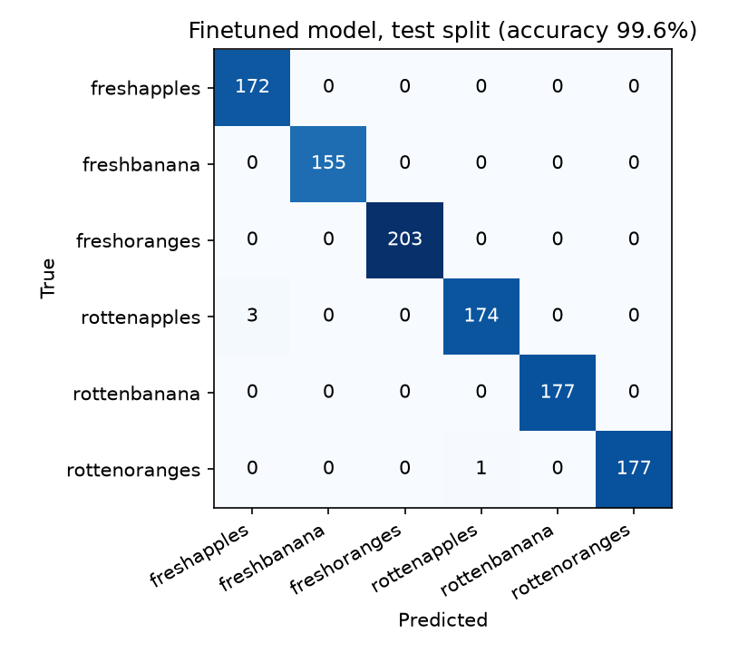
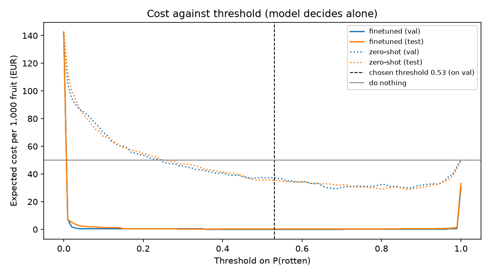

# Assignment 2 Report

- **Name**: Tomas Lock
- **Student ID**: 18613
- **Email**: tlock.ieu2022@student.ie.edu
- **Group**: BBADBA 5A

## Business problem, and the cost of being wrong

**The decision.** A fruit packing house sorts apples, bananas and oranges on a
conveyor belt before packing them into boxes for supermarkets. A camera
photographs each fruit as it passes, and the model decides, fruit by fruit,
whether it goes into the box. An air jet acts on the decision and blows
rejected fruit off the belt into a juice bin. One case is **one fruit**. The
**positive class is rotten**, because rotten fruit is what the line has to act
on.

There are three outcomes, not two: **pass** (into the box), **fail** (air jet
removes it), or **review** (diverted to a person who checks it by hand).

**A false negative** (rotten fruit passed into a box) is the expensive mistake,
because its cost lands outside the company. The supermarket receives it, which
means refunds, complaints and claims charged back to the supplier. Rot also
spreads: a rotten fruit makes the fruit touching it in the box rot faster, so
one miss can spoil more than itself.

**A false positive** (good fruit blasted off) costs much less, because the
fruit isn't thrown away. It goes to juice and concentrate producers, which
accept lower grades. The loss is only the difference between the fresh price
and the juice price.

With the figures in the cost section, **a false negative costs about 7 times
as much as a false positive** (€1.00 against €0.15). Everything downstream
follows from this. Rotten recall matters more than precision. When in doubt
between passing and removing, removing is cheaper. And a person is worth paying
wherever the model is unsure, because a hand check (€0.014) is far cheaper than
either mistake.

## Dataset

- **Roboflow Universe**: workspace `fruit-fresh-rotten`, project
  `fresh-rotten-6yh5b`, **version 1**, used as published (not forked).
  https://universe.roboflow.com/fruit-fresh-rotten/fresh-rotten-6yh5b
- **Task**: image classification. One image normally shows one fruit, which is
  the same unit as the decision on the belt.
- **Classes** (6): `freshapples`, `freshbanana`, `freshoranges`,
  `rottenapples`, `rottenbanana`, `rottenoranges`.
  Rotten = `rottenapples` + `rottenbanana` + `rottenoranges`.

**A labelling oddity I checked.** On Roboflow's class page the 780 fresh banana
images appear as "Unlabeled", because the author tagged them `freshbanana`
instead of assigning a class. I first planned to drop bananas: with rotten
bananas but no fresh ones, a model could learn "banana = rotten". But the
downloaded export does put them in a `freshbanana` folder. So I kept all six
classes and lost no data.

**Why it serves the problem.** The labels are exactly the decision (rotten or
not), per fruit, for the fruit the line handles. The main gap is the setting:
these are still photos taken in a similar setup, often with the fruit in
similar positions, not a moving belt under factory lighting. That limits how
far the results transfer (see Limitations).

## What the dataset's composition implies

**Splits.** Version 1 is split 80% train / 20% valid / 0% test, so it has no
test set. I used Roboflow's "valid" as my **test set**, never seen during
training or when choosing thresholds. I split off 15% of Roboflow's train set,
stratified by class with a fixed seed (42), as my **validation set**. YOLO uses
it to pick the best epoch, and I use it to choose thresholds. Using one set for
both jobs would make the test score optimistic.

| Class | Train | Val | Test |
|---|---|---|---|
| freshapples | 592 | 105 | 172 |
| freshbanana | 531 | 94 | 155 |
| freshoranges | 632 | 111 | 203 |
| rottenapples | 654 | 116 | 177 |
| rottenbanana | 608 | 107 | 177 |
| rottenoranges | 591 | 104 | 178 |
| **Total** | **3,608** | **637** | **1,062** |

**What it implies:**

- **Balance.** Every class has 531–654 training images and 155–203 test images,
  so none is too thin to train on. But the test classes are small enough that a
  single error moves a class's recall by about 0.6 points. Rotten-apple recall
  of 98.3% (174 of 177) has a 95% interval of roughly 95.1%–99.4%, so "98.3%"
  is less precise than it looks.
- **The test set is 50% rotten (532 of 1,062); production isn't.** I assume 5%
  of incoming fruit is rotten. At a low base rate, any false-alarm rate produces
  many false alarms for each rotten fruit caught. So raw test precision
  overstates production precision, and all costs are reweighted to the 5% base
  rate rather than taken from the test mix.
- **Images and object size.** Every image is exactly 640×640 pixels, so the
  version was resized when it was exported. The model trains at 224×224, which
  is enough for rot covering a visible patch but could miss very small spots.
  There are no boxes in classification, but the fruit fills most of the frame,
  so the model never has to find a small fruit in a busy scene, unlike a belt
  camera.
- **Near-duplicates.** 354 of the 1,062 test images (33.3%) are near-identical
  to a training image (`results/near_duplicate_examples.png`). Looking at them,
  they aren't the same photo or the same fruit, but the same kind of fruit in
  the same setup and a very similar position. So a third of the test set
  closely resembles training conditions. The test score measures performance
  on photos like the training ones, which is easier than a real belt, and will
  be optimistic.
- **Some images break the "one fruit" assumption.** A few `rottenapples` images
  show several apples, some fresh and some badly rotten, with the whole image
  labelled rotten. These are exactly where the model fails (below).
- **What I can't conclude:** how the model does on other varieties, under belt
  lighting, or on fruit whose rot faces away from the camera.

## Finetuning and baselines

**Model.** `yolo11n-cls`, finetuned from its pretrained checkpoint. I chose
classification because each image shows one fruit and the decision is per
fruit, so boxes add nothing. I chose the nano size because six visually
distinct classes don't need a bigger model, and it trains in minutes on a
laptop.

**Training.** Trained on my MacBook Pro (Apple M3 Pro GPU, via MPS): 20 epochs,
image size 224, batch 32, seed 42, all else Ultralytics defaults (AdamW,
learning rate 0.001, chosen automatically). The best epoch was chosen on the
validation split, where it reached 100% accuracy. Curves are in
`results/training_log.csv`.

**Baselines.**
- **Zero-shot pretrained.** The `-cls` checkpoints are pretrained on ImageNet
  (1,000 classes), not COCO. ImageNet has apples, oranges and bananas but no
  "rotten" class, so the model can't output our six classes. I used it as a
  rotten detector: rotten score = 1 − P(any ImageNet fruit class). The idea is
  that rotten fruit stops looking like a normal fruit to it.
- **Trivial.** For the 6-class task, always predict the most common training
  class (`rottenapples`). For the business decision, pass everything, which is
  the same as doing nothing.

Same test split for all (`results/metrics.json`,
`results/operating_point.json`):

| Model | Accuracy (6 classes) | Rotten recall @0.5 | Rotten precision @0.5 | AUC | € per 1,000 at its best threshold |
|---|---|---|---|---|---|
| Finetuned yolo11n-cls | 99.6% | 99.4% | 100% | 1.000 | 0.28 |
| Pretrained, zero-shot | n/a | 81.4% | 81.5% | 0.894 | 32.29 (threshold 0.68) |
| Trivial | 16.7% | 0% | n/a | 0.500 | 50.00 |

The finetuned model beats both baselines by a wide margin: per 1,000 fruit, it
cuts the cost of doing nothing from €50.00 to €0.28. The surprise was the
zero-shot model. Without ever seeing a rotten label, it separates rotten from
fresh with an AUC of 0.894, because rot makes fruit stop resembling ImageNet's
fruit classes. Its top guesses show this: fresh fruit is mostly "Granny Smith", "banana" or
"orange", but rotten oranges are most often called "French loaf", rotten
bananas "slug", and rotten apples "pomegranate", "spaghetti squash" or
"bagel". It still costs over 100 times more than
the finetuned model per 1,000 fruit, so it isn't usable as it is. The
finetuned gap is larger than I expected. Given the near-duplicates, part of it
reflects how similar test photos are to training photos.

## Per-class evaluation and failure modes

Positive class: **rotten** (`rottenapples` + `rottenbanana` +
`rottenoranges`).

| Class | Precision | Recall | Test images |
|---|---|---|---|
| freshapples | 98.3% | 100.0% | 172 |
| freshbanana | 100.0% | 100.0% | 155 |
| freshoranges | 100.0% | 100.0% | 203 |
| rottenapples | 99.4% | 98.3% | 177 |
| rottenbanana | 100.0% | 100.0% | 177 |
| rottenoranges | 100.0% | 99.4% | 178 |

**Bananas carry the headline.** Both banana classes are perfect, and
freshoranges is too. **Rotten apples drag it down**, and they're the only
class that causes a costly mistake. Three rotten apples were predicted as
fresh apples, which is why freshapples precision is 98.3%. Those are false
negatives: rotten fruit that would be boxed.

All three are images showing **several apples at once, some fresh and some
very rotten**, labelled `rottenapples` as a whole. Most of the image looks like
fresh apples, so the model says fresh. Their P(rotten) was 0.0003, 0.066 and
0.394. The first is confidently wrong: no threshold could catch it without
also removing almost every fresh apple. The failure isn't random: the model reads the overall look
of the image, so a small rotten share inside a mostly fresh scene gets missed.

The one rotten-orange error was predicted as a rotten apple. That confusion
costs nothing, because it's still rotten and still removed. Confusing fruit
types never matters for this decision; only rotten ↔ fresh does.

## Cost matrix and operating point

Costs in euros per fruit, relative to a perfect sort, for an average fruit of
about 180 g:

| Outcome | Cost (€) | Where the figure comes from |
|---|---|---|
| False negative: rotten fruit boxed | 1.00 | Credit for the fruit (~€0.16) + rot spreading to ~1.5 neighbours in the box (~€0.25) + an expected share of retailer claims and complaint handling (~€0.60). The claims part is the least certain |
| False positive: good fruit removed | 0.15 | (Fresh price at packhouse exit ~€0.90/kg − juice price ~€0.15/kg) × 0.18 kg ≈ €0.135, + ~€0.015 for bulk handling of the juice bin |
| True positive: rotten fruit removed | 0 | Worthless either way; removing it is the job |
| True negative: good fruit boxed | 0 | The normal outcome |
| Human review of one fruit | 0.0144 | 4 seconds × €13/hour |

Price sources: Spanish agriculture ministry price chain for Golden apples
(origin, wholesale, retail); European industrial apple prices of about
€0.15–0.17/kg, typically 1/5 to 1/10 of fresh prices; Spanish retail around
€2.40/kg, matching Mercadona. I use the packhouse price (€0.90/kg), not retail,
because the cost is what this company loses. The wage is the 2026 Spanish
minimum wage (€17,094/year) plus about 30% employer social security, over
about 1,800 working hours.

**Base rate: 5% of incoming fruit is rotten.** 10% seemed too high for fruit
that has already passed harvest selection, so I use 5% as the main case and
test 1–20% below.

**Method.** For every threshold from 0.00 to 1.00 in steps of 0.01, I measured
the share of rotten and of fresh fruit that would be removed. I weighted those
shares by the base rate and costs to get the expected cost per 1,000 fruit. I
took the cheapest threshold **on the validation split**, then reported its
cost **on the test split**. When several thresholds tie, I take the middle of
the tied range, which is least sensitive to small shifts in the scores.

**Chosen threshold (model deciding alone): 0.53.** On test it costs **€0.28
per 1,000 fruit**: 3 of 532 rotten fruit passed and no good fruit removed,
against €50.00 for doing nothing.

**Sensitivity** (`results/sensitivity.csv`). The model makes no errors on the
validation set, so the cost is zero across a whole range of thresholds, whatever
the costs or base rate. The chosen threshold stays at 0.53 across base rates
from 1% to 20% and false-negative costs from ¼× to 4×. What does change is the *value* of the decision. Each rotten
fruit missed costs €1.00, so the error rate in production matters far more than
the exact threshold.

**The assumption that would most change the answer is the model's real error
rate, not a cost figure.** On test it misses 0.56% of rotten fruit, which at
100,000 fruit a day and 5% rotten is about 28 rotten fruit boxed a day (≈€28).
If the true recall were the lower end of its interval (~95%), that becomes
about 250 a day (≈€250). On false alarms, 0 of 530 fresh fruit were removed,
but with 530 cases the true rate could still be up to about 0.6% (rule of
three). At 95,000 fresh fruit a day that's up to ~540 good fruit to juice
(≈€81 a day).

## What a person still has to check

**What the sweep says.** Searching all pairs of thresholds on validation (in
steps of 0.01), the cheapest band that fits 1 reviewer is **empty**: pass below
0.53, fail above. Validation has no errors, so there is nothing for a person
to catch. That is an honest result about this data, but a weak basis for
production, where photos will be harder.

**First attempt at a band, and why it failed.** A hand check costs €0.0144.
For a fruit with probability *q* of being rotten, reviewing beats passing when
*q* × €1.00 > €0.0144, i.e. *q* > 1.4%. Reviewing beats removing when
(1 − *q*) × €0.15 > €0.0144, i.e. *q* < 90%. Reading the model's score
directly as *q* gives a band of 0.01–0.91. On test, that band sent 26 fresh and
4 rotten fruit to review and caught 2 more rotten fruit than the model alone.
But it cost **€0.77 per 1,000**, more than the €0.28 of the model alone.

The mistake: the model learned on data that is 51% rotten, so its score is a
probability *in a 50/50 world*. On the line only 5% is rotten, so a score of
0.30 means a real chance of about 2%. The band was mostly paying people to look
at fresh fruit.

**Corrected band.** Converting the score to the 5% base rate (real-world odds
= model odds × (5/95) ÷ (51/49) ≈ model odds × 0.05), the same break-even
rule gives:

- review beats passing above a model score of about **0.23** (real chance of
  rot 1.4%)
- review beats removing below a model score of about **0.99** (real chance of
  fresh 9.6%)

So I'd ship with **pass below 0.23, review from 0.23 to 0.99, fail above
0.99**. `costing.py` computes this band from `config.py` and saves it as
`shipped_band` in `results/operating_point.json`, and the dashboard opens on it. The band comes from the cost figures and the base rate, not from
taste. It still assumes the scores rank fruit sensibly, which the AUC of 1.000
supports on this data.

On the test split this band sends 12 rotten fruit and 1 fresh fruit to
review, catches one more rotten apple than the model alone (the one scoring
0.394), and wrongly removes no fresh fruit. It costs **€0.23 per 1,000**, the
cheapest option, and sends **0.3%** of fruit to a person.

- At 100,000 fruit a day, that's **about 292 fruit a day**.
- At 4 seconds each, that's about 20 minutes of work, or **0.04 people** on
  8-hour shifts.
- One reviewer can check at most 7,200 fruit a day (7.2% of the line), so the
  band is realistic as long as fewer than about 7% of fruit fall into it. On
  test it uses about 4% of one person's day, so one reviewer could combine it
  with other line work. If a real belt produced more
  uncertain fruit than one person can handle, the band would have to narrow,
  starting from the top end, where a mistake only costs €0.15.

Assumption: a reviewer always decides correctly. If not, review is worth less
than shown.

**Against the alternatives** (test split, per 1,000 fruit):

| Strategy | € per 1,000 | Share to a person | People needed |
|---|---|---|---|
| Do nothing (pass everything) | 50.00 | 0% | 0 |
| A person checks everything | 14.44 | 100% | 13.9 |
| Model decides alone (threshold 0.53) | 0.28 | 0% | 0 |
| Model + uncorrected band 0.01–0.91 | 0.77 | 4.7% | 0.65 |
| **Model + corrected band 0.23–0.99 (shipped)** | **0.23** | 0.3% | 0.04 |

Letting the model decide is far cheaper than either alternative without it.
Per day at 100,000 fruit, it costs about €28, against €5,000 for doing
nothing or €1,444 plus 14 people for checking everything by hand. The corrected
band is cheaper still, at €0.23 (≈€23 a day), for 20 minutes of a person's
time. On test it improves only slightly, because the test set has almost no
uncertain fruit. Its real value is insurance on a real belt, where photos are
harder. I would
ship the model with the corrected band, but only after testing it on real
photos from the line camera, because this test set is too similar to the
training set to prove performance there.

## Limitations & next steps

- **The photos aren't belt photos.** They're still images taken in a similar
  setup, and a third of the test set closely resembles training images. Next
  step: collect a few hundred labelled images from the actual line camera and
  measure the model on those before trusting its error rates. Then finetune on
  them if performance drops.
- **Near-duplicate conditions between train and test** (33.3%). Next step:
  split by photo session or source rather than at random, so the test set
  contains conditions the model has never seen.
- **Multi-fruit images.** Images with several apples, only some rotten, cause
  all the costly errors. Next step: on the real line, fruit is singulated (one
  per photo), which removes this case. If whole-crate photos were needed
  instead, switch to object detection, so each fruit gets its own decision.
- **Rot facing away from the camera.** One photo shows one side of the fruit.
  Next step: use the line's fruit rotation and several images per fruit, and
  flag the fruit if any image looks rotten.
- **Tiny error counts.** With 3 errors in 1,062 test images, the error rates
  have wide intervals, and the threshold was chosen on a validation set with no
  errors at all. Next step: a much larger and harder test set before relying on
  the costs.
- **Cost figures are estimates.** The €0.60 claims share in the false-negative
  cost is the least certain. Next step: replace it with the packing house's
  real claims history.
- **The scores are probabilities for a 50/50 world.** I corrected them to the
  5% base rate with a simple odds adjustment, which assumes the model's scores
  are otherwise well calibrated. Next step: check calibration on real line
  data, e.g. among fruit scored around 0.5, what share is actually rotten.
- **I looked at the test set when choosing the band.** The correction was
  motivated by the base-rate argument, not tuned on test, but I noticed the
  first band's problem from its test result. So the €0.23 is slightly
  optimistic. Next step: choose any future band changes on validation only.
- **Reviewers are assumed perfect.** Next step: measure how often a person gets
  it wrong at line speed, and add that to the review cost.

## Generative AI use disclosure

I used Claude (Anthropic) throughout this assignment, as our professor allowed.
Claude wrote the code (`config.py`, `train.py`, `costing.py`, `app.py`) and
explained how each part works. It helped structure this report and draft its
wording from my decisions and results. It also found public price and wage
sources and proposed how to build each cost figure from them.

The decisions are mine: the business problem and its framing (the air-jet
sorting line), the dataset, the positive class, checking the banana labels and
choosing to keep all six classes, using Roboflow's valid split as the test set
(chosen from options Claude laid out), accepting the cost figures after
checking them against prices I know from Mercadona, and shipping the corrected
review band after the first version proved more expensive on test. I also inspected the
misclassified images and the flagged near-duplicates myself and drew the
conclusions about them,.